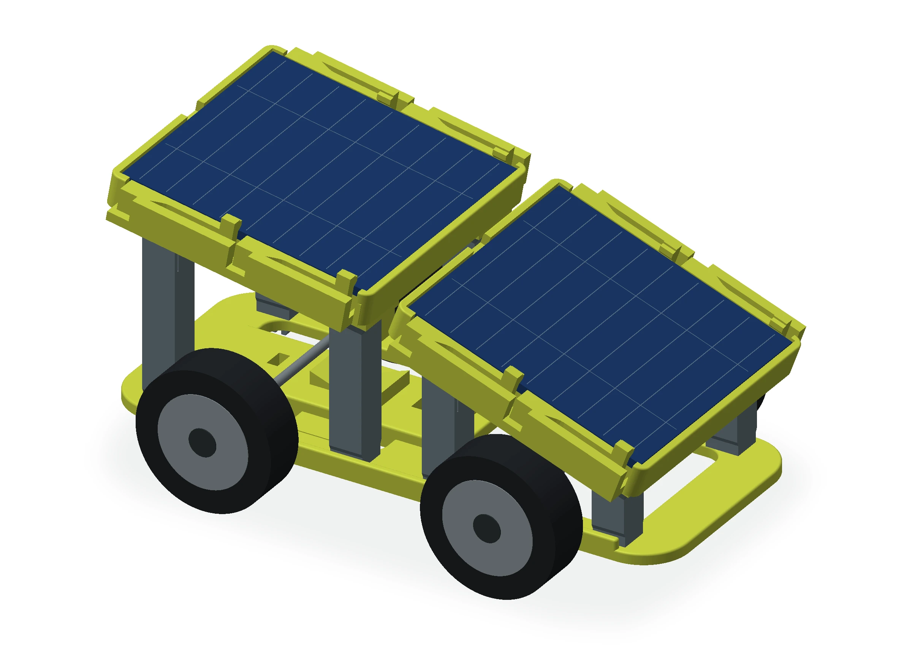
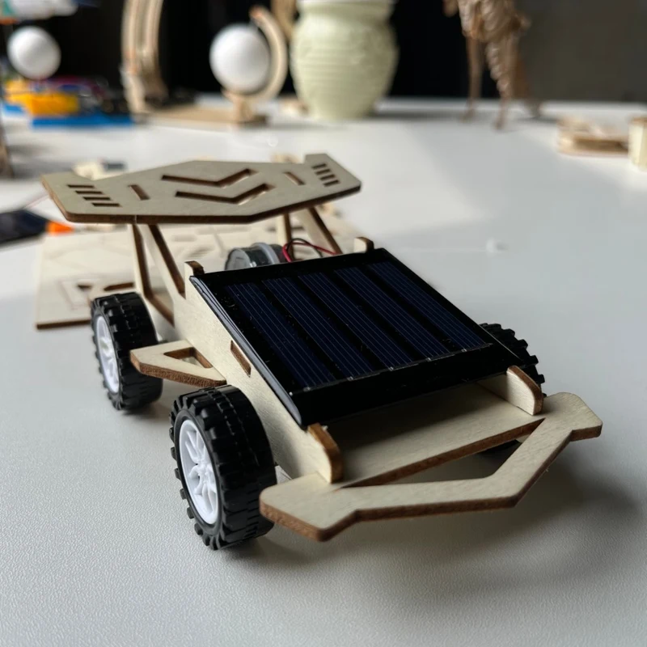
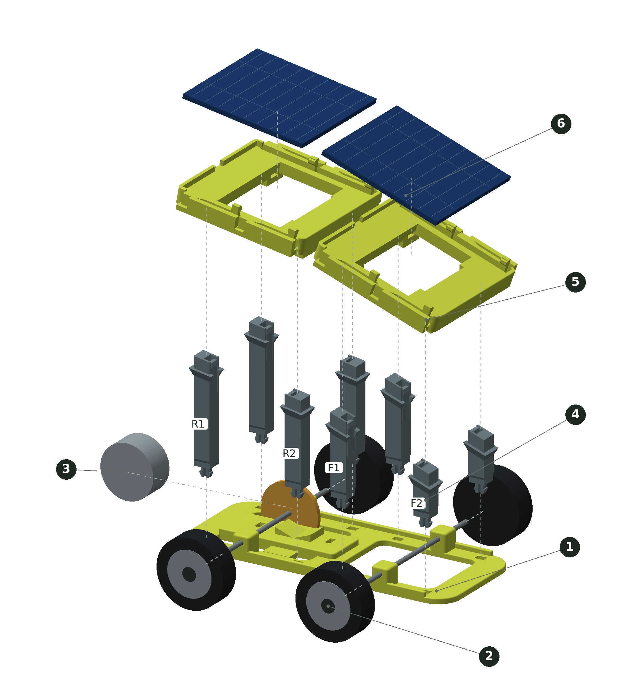

# Solar Car

A small car powered by two solar panels, with a 3D-printed chassis, panel frames, and support posts. **On November 22, 2026, the builder confirmed that the car was assembled and working.** This is a working physical build; speed, pulling force, and endurance have not been measured.

Website: [solar-car.pechenko.org](https://solar-car.pechenko.org/) (English, Russian, Simplified Chinese, French and Spanish). Repository: [parilo/solar_car](https://github.com/parilo/solar_car). License: [MIT](LICENSE).



## Print files

The current design combines the **V2.10 chassis** with the **BF5 panel mounts**. All STL files are in [models/print](models/print). They contain **no built-in supports**. Units are millimeters; print at 100% scale.

| Part | File | Quantity |
| --- | --- | --- |
| Chassis with integrated motor cradle | `solar-car-chassis-v2_10.stl` | 1 |
| Front panel frame | `solar-car-bf5-F-frame.stl` | 1 |
| Rear panel frame | `solar-car-bf5-R-frame.stl` | 1 |
| Front posts | `solar-car-bf5-F1-post.stl`, `solar-car-bf5-F2-post.stl` | 2 of each |
| Rear posts | `solar-car-bf5-R1-post.stl`, `solar-car-bf5-R2-post.stl` | 2 of each |

There are **11 printed parts** in total. `solar-car-bf5-frames.stl` and `solar-car-bf5-posts.stl` are combined print layouts of the same frames and posts. **Use either the layouts or the individual files, not both.**

The car was printed in PETG on a Creality Ender 3 S1. Set orientation and supports in your own slicer. G-code is not included. [STEP files](models/step) are available for CAD use; `assembly-reference.step` includes reference solar panels and is for inspection, not printing as a single object.

## Hardware and dimensions

The solar panels, motor, axles, gears, and wheels came from **two SICWUD wooden solar car kits** from [this Temu listing](https://www.temu.com/goods.html?goods_id=606027684660893&sku_id=93361448944809), in the **Solar car** variant. The builder supplied the exact product link. Each kit has one panel, so this two-panel car needs **two kits**. Use both panels and one set of drivetrain parts; the second motor and remaining parts are spares.



Product photo from the linked listing; it is not covered by this repository's MIT license. See [asset sources](docs/ASSET_SOURCES.md).

The dimensions used in the build are:

- Two 55 × 55 × 2 mm solar panels, with solder joints protruding approximately 2 mm below the back surface.
- A 24 mm diameter motor, held with a cable tie in the integrated chassis cradle.
- 2 mm diameter axles; 2.3 mm printed bores were selected for free rotation.
- 30 mm diameter, 10 mm wide wheels; 63 mm wheelbase.
- A 15.00 mm gear center distance, selected using printed test pieces; the small pinion has 10 teeth.
- Wires and a 4 mm wide cable tie.

The large gear's tooth geometry and the electrical ratings of the panels and motor are not specified by this model. Check compatibility when using different hardware. Wheels in the CAD illustrations are schematic; they are not printable models of the purchased components.

### Separate components on Temu and AliExpress

These are **unvalidated alternatives**, not the components tested in the completed car. The product pages were checked on November 22, 2026. Availability, shipping and minimum order quantities vary by region.

| Component | Direct product listing | Quantity needed / pack contents | What to check |
| --- | --- | --- | --- |
| Motor | [RF-300CA-09550 — AliExpress, Motor Studio Store](https://www.aliexpress.com/item/1005006061376932.html) | 1 motor; no gear included | Seller drawing: body Ø24.3 × 12.4 mm, exposed shaft 6.2 mm. Slightly larger than the measured Ø24 × 12 mm donor motor. Check cradle and pinion fit, gear alignment and operation with the panels; the title lists 1.5–6 V. |
| Wheels and axles | [GUDYIR 30 mm wheels with axles — Temu](https://www.temu.com/goods.html?goods_id=601102406768026) | Need 4 wheels and 2 axles; pack contains 8 wheels and 4 axles | Listed wheels Ø30 × 10 mm, for a 2 mm axle. Supplied steel axles are Ø2 × 100 mm and need cutting to fit. Check the wheel fit. |
| Panels | [ALLMEJORES 55 × 55 mm, 2 V panels — AliExpress, MSL Solar Company Store](https://www.aliexpress.com/item/1005012060244981.html) | Need 2 panels; pack contains 5 | Wires included. Thickness is not specified; these frames require 2 mm panels with a suitable inactive border. Confirm thickness and electrical compatibility. The listed voltage is not a rating for the original kit. |

Also needed: two Ø2 mm axles, a matched gear pair, wires and a 4 mm cable tie. Reuse the donor kit's matched gears. A 10-tooth pinion and a 15.00 mm center distance alone do not identify a compatible gear set; a complete separately sourced drivetrain has not been verified.

The front panel is tilted by 20° and the rear panel by 10°. The rear panel's center is 15 mm higher than the front panel's center. All posts are straight, with integral fasteners at both ends. The accepted upper fit corresponds to SC1 test pieces **post 1 + socket 6**. The lower snap joints fit the existing 4.2 × 2.8 mm chassis slots.

## Assembly

[](docs/assembly-exploded.png)

The diagram uses the released STEP geometry. Purchased parts are simplified references; gear teeth, wiring and the cable tie are omitted. This is a mechanical assembly illustration, not an electrical schematic.

1. **Chassis:** the motor cradle and axle supports are integrated into the base.
2. **Wheels and axles:** four wheels, two axles; the large gear sits on the rear axle.
3. **Motor:** seat it in the cradle, align the gears and secure it with a 4 mm cable tie.
4. **Posts:** two each of F1, F2, R1 and R2. F means front frame, R means rear frame. Type 1 is at the rear edge of each frame; type 2 is at the front edge.
5. **Frames:** insert the posts from below into the empty frames, then engage the lower chassis snaps.
6. **Panels:** route the wires through the openings and install the panels last.

[Panel mounting and assembly guide (PDF, English)](docs/panel-assembly.pdf).

Assembly order:

1. Print the parts, remove supports, and label the posts F1/F2/R1/R2.
2. Install the axles, wheels, gears, and motor. Check that the wheels rotate freely.
3. Insert the posts into the empty panel frames from below, with the upper latch tongues facing the central openings. Type 1 belongs at the rear edge of each frame; type 2 belongs at the front edge.
4. Align the lower snap stems with the chassis slots and engage them one at a time. Press near each post, not on the flexible panel clips.
5. Route the wires through the central openings and install the panels.

To remove a post from the chassis, squeeze its two lower prongs from underneath and push the stem upward. Release the upper joint by pressing the latch tongue through the side window of the socket. Fit depends on the printer, material, and print orientation.

## Rebuild the models

Use a Python version supported by CadQuery 2.8.0. The original environment used Python 3.11.

```sh
git clone https://github.com/parilo/solar_car.git
cd solar_car
python3 -m venv .venv
. .venv/bin/activate
pip install -r requirements.txt
python cad/build.py --output build
python cad/verify.py --build build
```

`build.py` exports STL and STEP files, an assembly for inspection, and a validation report. `verify.py` compares the rebuilt geometry against the released STEP files. The scripts do not depend on historical project archives or Onshape.

- `cad/chassis.py` — the one-piece V2.10 chassis.
- `cad/panels.py` — shared helpers, panel clips, and panel positions.
- `cad/frame.py` — BF4 frames and upper joints, retained in BF5.
- `cad/posts.py` — BF5 posts with lower snap joints.
- `docs/validation.json` — dimensions and the scope of reported validation.
- `scripts/build_assembly_guide.py` — generates the English PDF guide; requires ReportLab and Pillow.
- `scripts/package_downloads.py` — refreshes the website's download archives.
- `scripts/build_site.py` — builds the five language pages using the Python standard library.
- `scripts/render_exploded.py` — renders the exploded view from `models/step/assembly-reference.step`; additionally requires Pillow, Numba, SciPy and the DejaVu Sans fonts. Run `python scripts/render_exploded.py`.
- `site/` — the static, single-page project website.

## Website and video

[Watch the assembled car drive on YouTube](https://youtu.be/IwpP_UVUebM).

Preview the website locally with `python3 -m http.server 8080 --directory site`.

**English is the website's default language.** The header offers English, Russian (`/ru/`), Simplified Chinese (`/zh/`), French (`/fr/`) and Spanish (`/es/`). The visitor's choice is remembered when browser storage is available; browser language alone never changes the default. Each language has a complete static page and works without JavaScript.

Edit `web/template.html` for the shared layout and `web/locales/*.json` for translations, then run `python3 scripts/package_downloads.py`. This rebuilds the pages, sitemap and download archives. The generated HTML in `site/` is ready to serve without a build step on the server.

The assembly guide is available in English and Russian. The Russian page links to the Russian PDF; the other pages link to the English PDF and identify its language. Repository documentation remains in English.

The repository URL and YouTube video ID are set in `site/solar-car-assets/config.js`. The video section stays hidden until an ID is provided. Its poster is a frame from the builder's footage, at approximately four seconds, converted from HDR to SDR for the website. The player loads only after a visitor clicks; the website makes no requests to YouTube before that click. The original video and any third-party music are not included in this repository and are not covered by its MIT license. The third-party donor kit product photo is also excluded from MIT; see [asset sources](docs/ASSET_SOURCES.md).
